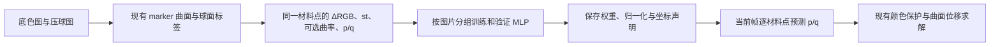

# 用 MLP 学习连续 LUT：文献调研与本项目接入方案

调研与实现日期：2026-11-07。状态：离散表与 M3/M5/M6/M8 已接入训练、分组验证、版本保存和两条重建入口；五方法对照通过 `calibrate-norm --stage compare` 生成。本文保留文献依据，并说明当前实现契约。

## 1. 核心功能与完整链路

建议用一个小型 MLP 学习**色差和位置到局部坡度的连续映射**，作为现有离散 LUT 的替代。训练监督直接采用球标定得到的逐点样本。本文将这一做法称为“连续 LUT”；它不要求先生成离散表再拟合表值。

M3 采用 `ΔRGB → (p,q)`，M5 采用 `ΔRGB + st → (p,q)`，M6 采用 `ΔRGB + k11,k12,k22 → (p,q)`，M8 采用 `ΔRGB + st + k11,k12,k22 → (p,q)`。曲率取自当前整体基准面。四者使用相同网络宽度、数据分组和验证流程，分别训练，每次部署只使用一个模型。编号就是输入维数；配置名称分别为 `mlp3`、`mlp5`、`mlp6`、`mlp8`，原离散表为 `table`。



MLP 替换颜色到坡度这一环。marker 整体曲面、约 7 mm 的两层偏移、冻结参考弧长图、黑框有效域和边缘零位移/零坡度约束继续由现有链路处理。

### 1.1 为什么值得尝试

本次诊断的 36 张图片共有 30,581 个有效球面标签样本。固定 28 张训练、8 张留出时，现有 `64³` LUT 的整体法向 RMS 为 21.82°；`32³` 为 22.48°，颜色 8 近邻加权为 22.04°。这些是本地诊断结果，不是 MLP 实验。

另一组保持相同分组的近邻诊断，用相同的单位法向平均方式比较：颜色输入的 RMS 为 21.63°，加入材料位置后为 18.45°。这组历史指标用于选择条件特征；实际 MLP 标定指标及保留的逐方法验证报告见 §4.2。

MLP 能连续共享样本信息，避免逐格估计再填补大量空节点。它仍受球面标签、训练覆盖和输入信息约束；相同输入对应不一致标签时，确定性网络也只能折中。

## 2. 逐环节功能说明

### 2.1 前人如何建立 LUT 或连续映射

| 工作 | 输入与输出 | 已核实的模型及数据做法 | 证据边界 |
|---|---|---|---|
| Yuan、Dong、Adelson，GelSight，2017 | 差分 RGB → 两个表面梯度 | `80³` 离散 LUT；不同位置压已知球，结果平均，未采样颜色插值 | 其相关精度评估使用标定图，不能等同整图留出泛化。[§3.3、§3.5、§5.1][gelsight2017] |
| Wang、She、Romero、Adelson，GelSight Wedge，ICRA 2021 | 差分 RGB + 图像 XY → `Gx,Gy` | `5→32→32→32→2`，tanh；半径 2.4 mm 球；32 张训练、8 张测试；另加约 5% 非接触零梯度数据 | 未明确损失、颜色线性化和输出层激活细节。[§IV-A、Fig.6][wedge] |
| Tippur、Adelson，GelSight360，RoboSoft 2023 | 归一化差分 RGB + 图像 UV → `Gx,Gy` | MLP；CNC 已知探测位置和传感器几何生成标签/接触 mask；10,000 个探测位置；约 25% 非接触数据 | 未披露层宽、激活和损失；“4 mm sphere”未明确半径/直径，非接触比例分母也未明确。[§IV、Fig.5][gelsight360] |
| Ren 等，GelLight，2025 | 差分 RGB + 图像 XY → `Gx,Gy` | GelNet：5 个全连接层，tanh，末层前 dropout；直径 8 mm 球，100 多张图、5,702,702 点；L1 + Adam | 9:1 训练/测试，但未说明是否按整图分组。正文训练参数为 batch 128、150 epoch、学习率 `1e-6`。[§3.2.3–3.2.5][gellight] |

这些 MLP 工作的共同路线是：**已知球形状产生逐点几何标签，网络直接回归梯度，并把位置作为输入描述照明不均匀**。它们没有证明仅增加网络容量就能消除光照歧义。论文中的像素梯度、方向角误差和深度误差，也不能直接与本仓库的三维法向 RMS 比较。

另有两项有针对性的补充：

- [VisTac，2023，§IV-A][vistac] 使用 RGB 与像素位置、`5→32→32→32→2` tanh 网络，并明确采用两维梯度 MSE，可作为梯度损失的先例。
- [Romero 的 MIT 硕士论文，2022，§5.4][romero] 针对半镜面及非均匀照明造成的颜色歧义，加入像素位置和 RGB 邻域预测法向。其位置/窗口消融主要报告训练误差；邻域方法也已经超出本文逐点小型 MLP 的首版范围。

[Taxim][taxim] 和 [FOTS][fots] 研究的是几何/法向到图像强度的正向模拟。FOTS 虽然使用 MLP，映射方向与这里的颜色到坡度不同。

### 2.2 开源代码中的“同一个网络”并不代表同一种标定

论文的 RGBXY、坡度和法向不能只凭变量名直接对应。核查了以下固定版本：

| 实现 | 实际约定 | 对本项目的影响 |
|---|---|---|
| GelSight 官方 `gsrobotics`，提交 `321d6a22…` | `5→64→64→64→2`、ReLU；预测 `nx,ny`，再算 `nz`，最后通过 `-nx/nz,-ny/nz` 得梯度；颜色通路使用当前图的 8 位值缩放 | 两个输出不是本项目的 `p,q`。需连同采集/示例调用检查通道次序及坐标 dtype；仓库未提供此权重的训练脚本。[固定版本源码][gsrobotics] |
| 公开标定工具 `joehjhuang/gs_sdk`，提交 `2359f036…` | `BGR/255 + XY`；`5→32→32→32→2`、ReLU、线性输出；两个梯度角为标签，角度 L1、Adam `0.002`、batch 1024、200 epoch；按图片约 80/20 划分 | 推理先取角度的 tan，再减背景预测梯度。这是代码的训练方案，不应替代 Wedge 原文中的 tanh 等描述。[训练源码][gs-sdk-train] |
| `ubi-coro/gelsight-calibration`，提交 `83976e88…` | `BGR/255 + [x/width,y/height]`；球面标签是两个 `atan2` 角度，推理用 `tan` 还原梯度并减背景预测 | 既不是线性色差输入，也不是直接坡度输出。数据准备、网络及保存/加载协议必须配套核查。[准备数据][ubi-prepare]、[推理][ubi-reconstruct] |

本项目继续使用线性、有符号的 RGB 色差，按自己的数据契约训练权重。上述预训练权重不能直接接到当前局部坡度求解器。

### 2.3 训练监督：从现有球标定样本出发

当前 [export_normal_samples](../calibrate/utils/norm_pipeline.py) 已导出下列逐点配对数据，`N` 为样本数：

| 字段 | 形状 | 含义与用途 |
|---|---|---|
| `color_residual_samples` | `N×3` | 同一材料身份的 `observed−reference`，有符号线性 RGB |
| `slope_samples` | `N×2` | 当前整体基准曲面局部正交基下的无量纲 `p,q` |
| `st_samples` | `N×2` | 冻结参考弧长坐标，取值在 `[0,1]` |
| `material_coordinates` | `N×2` | 原生材料参数，单位 mm；用于材料身份和延拓区判断 |
| `reference_normal_samples` | `N×3` | 标签转换所用的**当前整体基准曲面**单位法向 `n0`；字段名不表示固定底色图的相机法向 |
| `tangent_frame_samples` | `N×3×2` | 同一局部正交切基 `E=[e1,e2]` |
| `image_index`、`image_paths` | `N`、图片数 | 分组、逐图均衡和可追溯性 |

训练使用原始有效配对样本，不经过旧 LUT 的逐节点 MAD、5° 节点筛除或空格填补。几何/光度无效点继续排除；球面标签可信度需要另行核验。模型误差大的样本不能仅因“难拟合”就删除。

当前正式 LUT 与最近一批失败验证样本可能属于不同坐标图，不能作为这批样本的教师。若另做蒸馏实验，教师必须来自同一坐标图、同一训练分组；其填充值只能称为教师预测。

逐帧记录保存 `curvature_grid_per_mm(...,3)`，按同一个 `sample_valid_mask` 导出 `curvature_samples(N×3)`，顺序为 `k11,k12,k22`，以及 `curvature_valid_mask(N)`。它们作为 format 1 的可选字段，与颜色、坡度、st 保持完全相同的布尔索引顺序。旧样本缺少这些字段时，M6/M8 从匹配的 final 几何缓存只读重算；逐点核对颜色、坡度、st、材料参数、切基和 chart 后配对，沿用已有标注。

### 2.4 输入：颜色、位置与局部曲率分开定义

| 实验 | 输入 | 目的与部署方式 |
|---|---|---|
| M3，对照 | `ΔR,ΔG,ΔB` | 隔离“MLP 连续回归”的作用；可额外导出三维采样表作对照 |
| M5，位置条件模型 | `ΔR,ΔG,ΔB,s,t` | 检验材料位置条件；直接网络推理 |
| M6，颜色与曲率条件模型 | `ΔR,ΔG,ΔB,k11,k12,k22` | 直接检验局部整体弯曲状态对颜色到坡度映射的影响；直接网络推理 |
| M8，位置与曲率条件模型 | `ΔR,ΔG,ΔB,s,t,k11,k12,k22` | 在 M5 上加入局部曲率，检验整体弯曲状态的影响；直接网络推理 |

文献多使用图像 UV，本项目首选 st 是为了与现有冻结材料身份对齐，属于本项目的适配选择。UV 描述相机中的位置，st 描述材料位置；胶皮整体弯曲时二者不能互换。M6/M8 的曲率描述局部整体弯曲状态，三个分量保留弯曲方向与切基的关系；这一扩展属于本项目方案，不是前述论文已验证的输入组合。

曲率来自 **marker 重建并施加层间偏移后的当前整体基准接触面**，单位为 `mm⁻¹`；不用球面真值曲率、局部形变重建后的曲率或固定底色面的曲率作为输入。设 `J` 为该面网格的两个一阶导数组成的矩阵，`G=JᵀJ` 为第一基本形式，`B_ij=n0·X_ij` 为第二基本形式，`E=[e1,e2]` 为与坡度输出相同的正交切基：

$$
K=E^TJG^{-1},\qquad S=KBK^T,
\qquad (k_{11},k_{12},k_{22})=(S_{11},S_{12},S_{22}).
$$

`S` 是对称的局部曲率张量，其特征值就是现有实现的有符号主曲率。[compute_surface_geometry](../utils/surface_geometry.py) 已返回 `curvature_tensor`；其中 `geometry['k']` 表示上式的变换矩阵 `K`，不能直接当作曲率。曲率符号、切基方向和排列沿用该函数及冻结坐标约定，不另按主曲率大小重排坐标轴。

训练和推理都在整体基准面上采用同一曲率计算方法及法向约定，不借用球面标签或局部求解结果。当前标定最终面会排除接触 marker，而单图推理未采用相同排除，曲率特征可能存在分布差异；需要在真实单图链路验证，不能只比较公式一致。st 加曲率仍未必足以描述高度、整体朝向及阴影。

归一化仅由训练图计算并随模型保存：

$$
z_c=(\Delta C_c-\mu_c)/\max(\sigma_c,10^{-6}),\qquad z_s=2s-1,\quad z_t=2t-1.
$$

颜色与坡度均无量纲。M6/M8 的三个曲率分量分别使用训练组有效样本计算均值和标准差，按同样的标准化形式处理，尺度下限为 `1e-6 mm⁻¹`；单位、分量顺序及统计量随模型保存。几何邻域无效或曲率非有限时，将该点标记为曲率无效并排除其模型观测。归一化保留原输入范围，查询同时返回训练支持标记。

线性 NPZ 已完成入口线性化，不再次应用 BT.709 逆曲线。训练与推理均不经过检测器的 BT.709 编码适配，也不经过预览量化。特征顺序固定为上述表格顺序。

### 2.5 输出、网络与损失

首版网络选择 `D→32→32→32→2`，三个隐藏层为 tanh，输出层为线性；`D=5` 的 M5 有 2,370 个参数，`D=6` 的 M6 有 2,402 个参数，`D=8` 的 M8 有 2,466 个参数。宽度参考 Wedge，**线性输出与以下损失是本项目的方案**。首版不加入 BatchNorm 或 dropout，先控制模型与数据变量。

输出是 `p,q`，使用现有 [local_slopes_to_normals](../utils/surface_geometry.py) 恢复相机坐标法向：

$$
\widehat n=\frac{n_0-E[\widehat p,\widehat q]^T}
 {\|n_0-E[\widehat p,\widehat q]^T\|}.
$$

`n0`、`E` 与球面标签必须来自同一个当前整体基准曲面。不能把平面相机坐标下的 `nx,ny`、梯度角，或图像像素方向梯度直接作为这里的输出。

主损失采用可微的余弦法向误差。因 `n0,e1,e2` 正交归一，它等价于在局部基计算：

$$
\ell_i=1-\frac{1+\widehat p_i p_i+\widehat q_i q_i}
 {\sqrt{1+\widehat p_i^2+\widehat q_i^2}\sqrt{1+p_i^2+q_i^2}},
\qquad
L=\frac1K\sum_{k=1}^{K}\frac1{N_k}\sum_{i\in\mathcal I_k}\ell_i.
$$

`K` 是训练图片数，`N_k` 是该图有效样本数。图像等权可避免单张密集采样图主导训练；这是训练采样约定，不改变重建颜色方程等权的规则。训练时不用 `acos`，验证时仍计算真实三维法向角度 RMS。梯度 MSE 作为受控对照，不先混入多个损失权重。

若继承当前“零色差对应零局部坡度”的先验，可用残差形式硬编码：

$$
f_\theta(\Delta C,c)=g_\theta(z(\Delta C),c)-g_\theta(z(0),c),
$$

其中条件 `c` 按方法取材料位置、局部曲率或二者组合，零色差分支保持这些条件不变；`z(0)` 按上述训练均值和带下限的尺度计算，不是归一化后的零向量。这一先验应明确记录，且仍需评估现有零色差衰减后的实际输出。

文献加入的 5% 或约 25% 非接触数据不直接照搬。当前聚合样本主要来自球接触区；接触轮廓外的胶皮仍可能形变，不能全部标成零坡度。只有独立确认的无接触观测才能补充零标签。当前单图主链也尚未自动建立可信无接触 mask。

### 2.6 验证与训练支持范围

训练、归一化、早停、网络选择和支持距离阈值均只能使用训练侧数据。按整张图片分组，再在训练组内保留开发组；重复帧和同一压球序列放在同组。当前只有 `image_index`，按会话切分需要显式、可核验的 `session_id`，不能仅凭文件名暗中分组。

此前 8 张留出图已被多次分析和比较，只能继续作为历史开发基准。最终性能声明需要新的未参与调参的整图或采集批次；没有新测试集时明确标记“开发结果”。

每张图至少报告三维法向 RMS、median、p95、训练颜色范围外比例；另按 marker 参数域内/切线延拓区、位置、倾角与采集会话分组。保留当前配置的逐图 `20° RMS / 5% 颜色越界` 作为开发对照，不能换成整体平均过线；最终目标精度另由任务要求确定。

MLP 在任何数值输入上都能输出，不代表有训练支持。`SlopePrediction.supported_mask` 要求颜色处于训练范围内，且归一化完整特征的训练近邻距离不超过训练侧逐图排除自身距离的第 99 百分位。结果记录 `model_valid_mask`，与光度及先验来源分开。该判据是经验支持标记，不是可靠概率或数学外推保证。逐图还检查 `maximum_unsupported_fraction`（当前 5%），避免激活无法提供足够颜色方程的模型。

必须同时报告：

- 原始全部有效标签点的预测误差，包含不支持点，不能删去失败点后宣称通过。
- 支持区误差、拒绝比例及其空间分布；颜色通道越界与完整特征距离分别统计。
- 原始网络输出，以及应用现有零色差/可信无接触保护后端到端的结果。

几何延拓、颜色支持和光度有效是三个不同概念。最差诊断图中约一半标签依赖 marker 域外几何，这些标签仍缺少独立真值核验；网络拟合好它们不能证明真实几何准确。

### 2.7 部署：连续网络与导出离散表

M5/M6/M8 直接逐材料点推理。颜色采样、M5/M8 的 st、M6/M8 的局部曲率在同一材料网格上组装，结果交给现有曲面求解器。运行时在模型预测之前计算整体基准面几何，复用同一次计算的法向、切基和曲率。曲率求导只使用几何有效 mask，不用 marker 缺色或其他光度 mask 制造额外几何孔洞。

保留当前零色差及显式可信无接触先验的优先级：先验可独立于网络支持范围提供零坡度约束，但必须记录为先验，不能标成模型观测。M6/M8 的 `supported` 还须与曲率有效 mask 相交；曲率无效不会自动取消独立先验。

在有效几何内，分别定义原始光度 mask `photo`、模型支持 `supported`，以及既有保护逻辑认定的 `zero_prior`（含已启用的可信无接触点）。统一使用：

```python
prior_valid = photo & zero_prior
model_valid = photo & supported
equation_valid = model_valid | prior_valid
```

`prior_valid` 处坡度为零，其余模型点使用保护后的预测。颜色方程、连续性补洞和 `inferred_mask` 都必须以 `equation_valid` 判断是否有坡度约束；不能只给颜色方程叠加支持 mask，却让补洞继续判断原 `photo`。两类来源及原始光度 mask 分别输出。没有模型支持也没有先验的点保留几何未知量，通过连续性与边界约束处理；方程不足时显式失败。

M3 可在训练颜色立方范围内采样成 `64³` 表，比较连续网络与三线性查询的误差。现有 `NormalCalibration` 强制提供有限方差，查询会 clip 色差，且不按 `original_valid` 拒绝点，因此原运行时只能用于保留旧行为的数值对照。若要部署采样表，仍需扩展加载/查询契约，使其支持未知不确定度、显式支持标记和上述约束来源；旁置一个支持文件并不会自动改变旧查询行为。

导出时还应单独验证原有零点处理的影响；不能把生成节点标成实测节点，也不能用零方差伪装高可信度。

加入 st 或局部曲率后，映射成为五维、六维或八维，完整保留条件信息需要相应维数。当前通过连续网络直接推理这些条件模型。

## 3. 代码结构与确定接口（已实现）

### 3.1 模块边界

| 位置 | 当前职责 |
|---|---|
| [utils/normal_mapping.py](../utils/normal_mapping.py) | 已有离散 LUT 构造、保存和原始查询；保留作同分组基线 |
| [utils/surface_geometry.py](../utils/surface_geometry.py) | 返回局部曲率张量，复用几何有效性与切基 |
| [utils/normal_mlp.py](../utils/normal_mlp.py) | MLP 数据类、特征组装、NumPy 原始推理、NPZ 保存/加载 |
| [utils/normal_models.py](../utils/normal_models.py) | 统一加载及原始预测，保留 table 查询数值 |
| [calibrate/utils/train_normal_mlp.py](../calibrate/utils/train_normal_mlp.py) | 图像均衡训练、训练内早停、全部外层训练图重拟合 |
| [calibrate/utils/norm_pipeline.py](../calibrate/utils/norm_pipeline.py) | 五方法拟合、球面样本、分组验证、曲率配对、通过后发布 |
| [utils/calibration_store.py](../utils/calibration_store.py) | 版本目录与模型/网格统一选择 |
| [reconstruction/pipeline.py](../reconstruction/pipeline.py) | 读取所选方法的同版本模型与材料网格 |
| [reconstruction/local_recon.py](../reconstruction/local_recon.py) | 传递 st、曲率及支持标记，统一颜色保护与位移求解 |

`load_reconstruction_arrays → reconstruct_from_input → reconstruct_local_surface → lookup_slopes` 已贯通 st；M6/M8 在预测前由当前 `xyz` 及几何 mask 计算曲率。M6 直接使用色差和曲率，st 只参与 M5/M8 的特征组装。显式外部输入缺少模型所需条件时，在特征组装边界报错。

### 3.2 公共数据契约

轻量预测结果 `SlopePrediction` 包含 `slopes(...,2)`、`supported_mask(...)`，以及可缺省的 `variance`、`confidence`。模型必需特征缺失、形状错误或坐标声明不符时直接报错。

```python
def predict_normal_model(
    colors: np.ndarray, model, valid_mask: np.ndarray | None = None,
    *, st: np.ndarray | None = None,
    curvature_per_mm: np.ndarray | None = None,
    curvature_valid_mask: np.ndarray | None = None,
) -> SlopePrediction:
    ...

def train_normal_mlp(
    colors, slopes, image_index, *, method, st=None,
    curvature_per_mm=None, curvature_valid_mask=None, options=None,
) -> MLPCalibration:
    ...
```

`colors` 是线性有符号色差，最后一维为 3，st 为 2；`curvature_per_mm` 最后一维为 3，顺序为 `k11,k12,k22`，单位 `mm⁻¹`，其有效 mask 与前置维度一致。几何计算保持 float64 精度，网络输入为 float32。M6/M8 缺少曲率或有效 mask 时报错；逐点无效曲率只使该点的模型观测不可用。MLP 原始预测不应用颜色保护、不 clip 色差，也不改动几何/光度 mask；离散表仍保留原查询行为。

MLP 不自动具有 LUT 的节点方差。首版将其不确定度记为缺省，结果文件与调用方要支持省略。`supported_mask` 按 §2.7 形成模型约束，再与独立先验合成 `equation_valid`，贯通颜色方程、补洞和推断标记；保持与几何 mask、光度 mask 分离。置信度仍不进入求解权重。

统一加载器按 `model_kind` 分派，LUT 继续采用现有格式。MLP 模型同样提供 `metadata`，让现有参考图、相机、模板、坐标图、两层偏移及冻结网格的配套检查继续生效。`local_main` 和统一图片入口都需接入，不能只支持其中一条。

### 3.3 模型文件与发布

MLP 采用无 object 数组的 NPZ，`format_version=1`、`model_kind=mlp_local_slopes_v1`、`output_kind=local_slopes`，输出单位无量纲，并声明上述法向约定。保存每层 `weight_i/bias_i`、tanh/线性激活、特征顺序、归一化、零色差残差形式、支持参考特征及阈值。M6/M8 同时绑定曲率单位、排列、切基及当前整体基准接触面的来源。

模型元数据绑定 `coordinate_chart_id`、`domain_kind`、`coordinate_kind`、`frame_convention`、参考图、`contact_offset_mm`、球参数、`linear_rgb / bt709 / signed` 声明和图片分组。相机与模板保存在同版本冻结网格中，重建时逐项核验。`training_info` 记录随机种子、早停开发分组及训练历史，版本报告保存样本与模型 SHA-256。所有训练统计只从训练组得到。

验证前模型标为 `training_only` 或 `development_only`。新模型及其冻结材料网格先写入独立工作目录，完成验证和配套检查后再发布；失败时继续保留原模型。当前最新样本、训练 LUT 与旧正式 LUT 的配套关系应由 ID 核验，不能只凭文件名相同推断。

## 4. 其余实施细节

### 4.1 起始配置与依赖

以下为当前训练默认值，**不是文献复现参数或通过承诺**：

| 项目 | 起始值 |
|---|---|
| 方法选择 | `table` / `mlp3` / `mlp5` / `mlp6` / `mlp8`；默认保留原 `table` |
| 隐藏层 | 32、32、32；tanh，线性输出 |
| 优化 | Adam，学习率 `1e-3`，batch 1024 |
| 训练上限 | 200 epoch；训练侧开发集逐图平均角度 RMS 早停，patience 20 |
| 初始化/重现 | 固定分组与数据指纹，报告种子 42、43、44，不能按最终测试结果挑种子 |
| 输入统计 | 训练组逐颜色通道均值/标准差，尺度下限 `1e-6`；st 映射至 `[-1,1]` |
| M6/M8 曲率统计 | 训练组逐分量均值/标准差，尺度下限 `1e-6 mm⁻¹`；无效曲率不作零曲率输入 |
| 零色差 | 残差形式保证精确零色差零坡度；保护后的结果另行验证 |

训练使用现有 JAX 的 `jax.example_libraries.optimizers.adam`，仅在训练函数内导入，本次没有增加依赖。该模块在 JAX 官方文档中定位为示例优化器；当前实现通过小数据收敛、固定种子、JAX/NumPy 预测一致及模型往返验证。[JAX 文档][jax-optimizers] 推理仅需 NumPy 和经验支持查询，不导入训练框架。

配置的 `normal_calibration.method` 同时控制训练和重建读取，MLP 超参数位于 `normal_calibration.mlp`。模型按版本保存在 `lut/`，`assets/` 只保留原图、标注和几何/样本缓存。常用操作：

```bash
# 训练配置 method 指定的方法，验证失败时保留候选并报告失败。
uv run calibrate-norm --config config.yaml --stage fit
# 使用完全相同的外层图片分组拟合并比较五种方法。
uv run calibrate-norm --config config.yaml --stage compare
# 默认读取所选方法最近通过验证的模型与同版本网格。
uv run recon --config config.yaml --image assets/test_pics/3b3.npz
# 历史模型迁移；会先校验归档 SHA-256，再移除 assets 中的原模型。
uv run python -m calibrate.migrate_luts --config config.yaml
```

每次拟合保存 `normal_lut_train.npz`、候选/最终 `normal_lut.npz`、冻结网格、坐标图和 `validation.json`。方法目录的 `current.json` 仅在通过验证后更新；该方法尚无通过版本时，默认读取明确报错，不自动改读其他方法。失败候选可以通过显式 `--calibration` 做诊断，但不等同发布。

`--output` 只在验证通过后额外导出模型与配套文件，不取代规范版本目录，且不会覆盖不同的已有网格或坐标图。离散 LUT 专用可视化/节点质量工具遇 MLP 时提示使用 `--stage compare`。

### 4.2 标定结果与复现

本轮使用同一份 30,581 点样本、28 张训练图、8 张历史开发留出图，五方法统计完全相同的 6,552 个留出点。MLP 的早停只访问训练组内的开发图，随后用全部 28 张训练图按所选轮数重训。方法名称链接到各版本保留的 `validation.json`：

| 方法 | 整体法向 RMS | 支持范围外比例 | 逐图通过数 | 训练轮数 |
|---|---:|---:|---:|---:|
| [table](../lut/table/20261107_013205_200293_089654/validation.json) | 21.82° | 0%（沿用原查询） | 4/8 | 不适用 |
| [mlp3](../lut/mlp3/20261107_013207_678602_10fc0c/validation.json) | 19.05° | 6.65% | 6/8 | 60 |
| [mlp5](../lut/mlp5/20261107_013214_455600_66eb9c/validation.json) | 14.67° | 6.55% | 6/8 | 45 |
| [mlp6](../lut/mlp6/20261107_181143_300604_024ede/validation.json) | 19.50° | 8.03% | 6/8 | 36 |
| [mlp8](../lut/mlp8/20261107_013219_909155_e2b10b/validation.json) | 17.70° | 8.03% | 6/8 | 73 |

表中支持比例对 M5/M6/M8 使用各自完整五维/六维/八维特征；table 沿用有限输入可查询语义，颜色越界另列指标。M5 在本轮法向指标最好。五方法在同两张图有约 39.5%/10.3% 色差越界，按逐图发布规则保留为候选版本；默认 table 指针继续指向原已验证版本。

测试生成的重建点云、预览、诊断和对比报告已清理。当前保留各方法标定模型、配套网格、坐标图和逐方法验证报告。可从保留的训练组候选重新运行单图重建，例如：

```bash
uv run recon --config config.yaml \
  --calibration lut/mlp6/20261107_181143_300604_024ede/normal_lut_train.npz \
  --image assets/test_pics/3b3.npz
```

需要重新生成方法对照时，运行 `calibrate-norm --stage compare`，再将新生成的 `comparison.json` 交给 `calibrate.compare_reconstruction`。

### 4.3 必要验证与后续顺序

1. **固定数据与分组。**核验同一 chart、色彩和偏移声明，保存原始样本指纹；补齐会话信息，并安排独立的新测试图。
2. **实现 M3/M5 原始训练。**同样的图像均衡、损失与开发分组，保留已有 LUT/颜色近邻基准；不发布替代模型。
3. **验证公共边界。**检查样本与特征逐点配对、坐标/通道/符号、NPZ 往返及 NumPy/JAX 预测一致；检查缺少特征和错配模型会被拒绝。M6/M8 另核验平面、球面及旋转圆柱的曲率分量、法向符号和不同网格密度下的数值一致性。
4. **接入完整推理。**打通位置特征与支持 mask，验证 marker 缺色孔洞、不支持区域、无足够方程和现有边缘约束；分别报告 raw 与保护后结果。
5. **冻结方案后做新整图验证。**报告逐图与延拓区结果，再决定部署 M5、评估加入局部曲率的 M8，或回到标签/成像条件核验。

这一步的交付目标是验证“小型、位置条件的连续回归能否提高本传感器的跨图一致性”。没有通过新分组验证前，不能把训练误差下降写成重建准确度提升。

### 4.4 原始来源

论文事实使用原文，代码行为固定到提交；未披露的参数不由其他论文或当前 SDK 代填。传统 LUT 与 MLP 的数据准备、标签基准和指标差异见上文。

1. Yuan, W.; Dong, S.; Adelson, E. H. [GelSight: High-Resolution Robot Tactile Sensors for Estimating Geometry and Force][gelsight2017]. *Sensors*, 2017.
2. Wang, S.; She, Y.; Romero, B.; Adelson, E. [GelSight Wedge: Measuring High-Resolution 3D Contact Geometry with a Compact Robot Finger][wedge]. *ICRA*, 2021.
3. Tippur, M. H.; Adelson, E. H. [GelSight360: An Omnidirectional Camera-Based Tactile Sensor for Dexterous Robotic Manipulation][gelsight360]. *RoboSoft*, 2023.
4. Ren 等. [GelLight: Illumination Design, Modeling, and Optimization for Camera-Based Tactile Sensor][gellight]. *Advanced Intelligent Systems*, 2025.
5. Athar, S. 等. [VisTac: Towards a Unified Multi-Modal Sensing Finger for Robotic Manipulation][vistac]. *IEEE Sensors Journal*, 2023.
6. Romero, B. R. [Soft, round, high resolution tactile fingertip sensors for dexterous robotic manipulation][romero]. MIT 硕士论文, 2022.

正向模拟对照：[Taxim][taxim]、[FOTS][fots]。实现来源：[官方 gsrobotics][gsrobotics]、[gs_sdk 训练代码][gs-sdk-train]、[ubi 数据准备][ubi-prepare]与[推理代码][ubi-reconstruct]。训练库约定见 [JAX 官方文档][jax-optimizers]。

[gelsight2017]: https://pmc.ncbi.nlm.nih.gov/articles/PMC5751610/ "Yuan, Dong, Adelson. GelSight: High-Resolution Robot Tactile Sensors for Estimating Geometry and Force. Sensors, 2017."
[wedge]: https://gelsight.csail.mit.edu/wedge/ICRA2021_Wedge.pdf#page=4 "Wang, She, Romero, Adelson. GelSight Wedge. ICRA, 2021."
[gelsight360]: https://mhtippur.github.io/web/files/Gelsight360.pdf#page=4 "Tippur, Adelson. GelSight360. RoboSoft, 2023."
[gellight]: https://doi.org/10.1002/aisy.202400596 "Ren et al. GelLight: Illumination Design, Modeling, and Optimization for Camera-Based Tactile Sensor. 2025."
[vistac]: https://engineering.purdue.edu/~qqiu/pub/VisTac.pdf "Athar et al. VisTac: Towards a Unified Multi-Modal Sensing Finger for Robotic Manipulation. IEEE Sensors Journal, 2023."
[romero]: https://dspace.mit.edu/server/api/core/bitstreams/764544ae-b67c-4bec-ba94-e2f59b4e6739/content "Branden Robert Romero. Soft, round, high resolution tactile fingertip sensors for dexterous robotic manipulation. MIT master's thesis, 2022."
[taxim]: https://arxiv.org/abs/2109.04027 "Si, Yuan. Taxim: An Example-based Simulation Model for GelSight Tactile Sensors."
[fots]: https://kclpure.kcl.ac.uk/portal/files/256108122/FOTS-RAL.pdf "Zhao et al. FOTS: A Fast Optical Tactile Simulator for Sim2Real Learning of Tactile-motor Robot Manipulation Skills. 2024."
[gsrobotics]: https://github.com/gelsightinc/gsrobotics/blob/321d6a22da64529138ff10237335038fd8c5189f/utilities/reconstruction.py "GelSight official SDK, pinned reconstruction implementation."
[gs-sdk-train]: https://github.com/joehjhuang/gs_sdk/blob/2359f0367f9e7ca69b990309e9b41583e9261590/calibration/train_model.py "Pinned public calibration implementation: MLP, angular L1 loss and grouped training."
[ubi-prepare]: https://github.com/ubi-coro/gelsight-calibration/blob/83976e8834c1e35445b6ab261b792afc651ceb08/calibration/prepare_data.py "Pinned public calibration implementation: angle labels and image features."
[ubi-reconstruct]: https://github.com/ubi-coro/gelsight-calibration/blob/83976e8834c1e35445b6ab261b792afc651ceb08/gs_sdk/gs_reconstruct.py "Pinned public calibration implementation: angle-to-gradient inference."
[jax-optimizers]: https://docs.jax.dev/en/latest/jax.example_libraries.optimizers.html "JAX optimizer examples and recommendation to use Optax."
