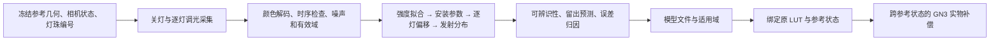

# 光场物理模型辨识与实物 LUT 补偿实施计划

归档状态（2026-11-06）：本计划对应的 `physical_model/`、`sim2real_trial/` 路线已暂时废弃，下文仅保留历史设计与实验背景，不再安排实施。旧目录已整目录忽略并移出 Git 跟踪，相关源码链接仅在保留本地旧代码时可用。

日期：2026-11-03。状态：初版设计记录；部分采集和光场辨识已有实现，实物 GN3 接入及形变效果尚未验证。当前实验入口见[实验区说明](../sim2real_trial/docs/README.md)。

**后续实验目标原则：我们不需要构建准确的模型，我们只需要这个模型能够预测弯曲后色差与法向量的关系。** 逐灯物理参数、复杂传播和参考 RGB 拟合是候选手段，不是独立目标；以原 LUT 迁移补偿后的法向及重建表现选择模型，保持既有 LUT 与 GN3 方法不变。后续工作应优先参考[目标导向的模型反思](lightfield_task_driven_reflection.md)。下文固定无接触采集及其验证范围保留为原方案，不表示它足以验证接触形变响应。

## 1. 核心功能与完整链路

目标是得到一个可调参、可评估不确定性、能被渲染和补偿共同调用的近场光照模型。推荐路线是：**以安装结构约束逐 LED 几何，通过逐灯无接触图像辨识有效光照参数，按可辨识程度逐步增加模型自由度，再将通过验证的模型用于实物 LUT 补偿。**不直接一次性联合优化所有灯位、材料和相机参数。

本方案初版遵循[文献调研](optical_model_review.md)中的无接触采集条件：使用固定无接触表面和逐 LED 调光；参考表面三维形状、相机参数大致已知。初版不要求额外标定球或带形变标签的数据，也不假定能获得多个已知曲面构型。可读取已有参考几何，不要求在每张单灯图像上重新检测 marker。这个限制适用于原无接触辨识方案；验证和优化接触法向响应需要独立形变证据，见上方目标导向反思。

输入包括：参考曲面的 XYZ、法向和有效域；实际使用的相机内外参及投影约定；灯带安装尺寸与逐灯编号；逐灯、关灯和混合照明图像；相机控制回读值与实际发送的灯珠 RGB 字节。后续接入补偿时，还需要原 LUT、对应的固定参考图及其几何、工作照明和颜色处理记录。

输出包括：逐灯参数及单位、驱动响应、可辨识性和误差报告、原始采集记录，以及绑定工作照明和相机状态的模型文件。验收区分三个目标：

| 目标 | 必须提供的证据 | 固定无接触采集能够支持的范围 |
|---|---|---|
| 参考光场预测 | 独立时间批次、空间区域、亮度档及混合照明的预测误差 | 可以直接检验 |
| 逐灯几何辨识 | 多初值稳定性、消除强度等干扰参数后的数据灵敏度、条件不确定性 | 可以检验局部可辨识程度；不保证每颗灯的全部参数都能恢复 |
| 形变响应与补偿 | 法向、深度响应及真实重建误差 | 只能在物理假设下预测；缺少独立形变观测时不能宣布实物补偿精度已验证 |

完整链路如下：



现有代码核对结果如下。新增能力都需要实施，不能由现有仿真实验结果代替。

| 环节 | 已有能力 | 本计划需要补充 |
|---|---|---|
| 解析渲染 | 平面、理想圆柱、有限宽灯带积分、CPU/CUDA、线性 RGB | 带硬件编号的逐灯位置和朝向、统一光源表、实测有效强度模式 |
| 仿真标定 | `physical_model/calibrate_lut.py` 及 `simulate_curve.py --calibrate-lut` | 真实光场辨识入口；保留虚拟 LUT 标定的既有职责 |
| 深度 GN3 | 理想参考几何上的坡度—深度优化，参考阴影冻结 | 实物曲面数组接口、相互独立的当前几何与固定光度参考、模型状态绑定 |
| 实物采集 | 相机采集、LED GUI、逐灯协议 | 无 GUI 的灯控传输、ACK 后新帧确认、照明与相机元数据 |
| 实物颜色 | BT.709 解码、有符号 RGB 色差、冻结材料坐标 | 辐射线性检查、模型辨识、逐灯驱动状态与 LUT 的绑定 |

## 2. 逐环节功能说明

### 2.1 前人方法的采用范围

以下是本方案直接使用的依据；更完整的文献列表仍保留在[调研文档](optical_model_review.md)。后续参数释放、采集和验收设计是本项目方案，不是对论文结论的照搬。

| 依据 | 借鉴内容 | 本项目的处理 |
|---|---|---|
| Coupry 等，SSVM 2025，[LED-getter 作者代码](https://github.com/BenjaminCoupry/LED-getter) | 已知粗几何，逐步使用更丰富的光源模型；LED 模型包含位置、强度、主轴、指数和反照率 | 借鉴模型分级和粗几何输入，不照搬全部自由度。作者[默认参数](https://github.com/BenjaminCoupry/LED-getter/blob/main/ledgetter/models/defaults.py)同时开放 LED 参数；本方案的逐组释放顺序是另行设计的 |
| Ji 等，Sensors 2022，[Model-Based 3D Contact Geometry Perception](https://www.mdpi.com/1424-8220/22/17/6470) | 无接触平面上通过图像残差拟合按颜色归并的等效光源，式 (6) | 支持建立无接触拟合基线；等效点不等于物理灯珠，不能据此证明逐灯全参数唯一 |
| Quéau 等，JMIV 2018，[LED-based Photometric Stereo](https://arxiv.org/html/1707.01018v2) | 近场距离衰减、余弦幂发射、主轴及有效强度；强度含相机和反照率尺度 | 采用紧凑物理参数化和尺度约定；原文镜面球及多姿态平面采集不进入本方案 |
| Park 等，CVPR 2014，[Calibrating a Non-isotropic Near Point Light Source using a Plane](https://openaccess.thecvf.com/content_cvpr_2014/html/Park_Calibrating_a_Non-isotropic_2014_CVPR_paper.html) | 平面空间亮度分布可提供灯位和发射分布线索，但使用多个相对姿态 | 提醒我们检查空间、角度覆盖；同一固定平面的多个亮度档不能替代多个姿态 |

LED-getter 的[配置](https://github.com/BenjaminCoupry/LED-getter/blob/main/config.sh)按 directional、rail、punctual、LED 等模型组织阶段；其 LED 模型同时优化反照率。这里优先采用安装结构先验和更少的外观参数，避免把“图像拟合收敛”解释为“真实灯位已恢复”。上述代码核对不构成固定平面可辨识性的理论证明。

### 2.2 将模型改为可约束的逐灯参数模型

**统一编号和安装坐标。**当前硬件配置为上 9、右 4、下 9、左 4，共 26 颗有效灯珠，前面另有 3 个熄灭位置。零基串行索引依次为：上 3–11、右 12–15、下 16–24、左 25–28；下边从右向左、左边从下向上。现有物理配置按左、右、上、下组织，不能直接复用数组索引。

为每颗物理灯建立稳定的 `led_id`，登记 `wire_index`、所属安装件、安装件内序号、标称位置、标称发射轴和允许偏移。积分节点另存 `owner_led_id` 与权重。当前解析配置的 52 个光源样本来自 26 颗灯各两个宽度积分点，不能作为 52 颗独立灯进行辨识。积分节点继承所属灯的参数，节点权重之和为 1。

所有计算使用同一个毫米坐标系。优先采用已有参考曲面的相机坐标系；仿真世界坐标通过显式刚体变换接入，点加平移、方向和法向只旋转。实际使用的 K、畸变参数和参考几何必须一起冻结，不能混用相机标定 YAML 与整体重建所读取的另一份 `camera_params.npz`。图像去畸变后拟合，或在原畸变域投影后拟合，二者选定一种并写入数据。

灯位和发射轴采用安装件局部坐标：

$$
\ell_j=T_{g(j)}(\ell_j^{\rm nominal}+\Delta\ell_j),\qquad
d_j=R_{g(j)}\operatorname{Rot}(\alpha_j,\eta_j)d_j^{\rm nominal}.
$$

$\ell_j$ 的单位为 mm；$d_j$ 为单位发射方向；$g(j)$ 是灯所属安装件；$T_g$、$R_g$ 为安装件到统一坐标系的变换；两角 $\alpha_j,\eta_j$ 用 rad 表示，不使用三个互相冗余的自由方向分量。共享安装变换与逐灯偏移不能无约束地同时漂移：先估共享变换并冻结，再估逐灯偏移；后续若联合细化，必须施加明确的零均值等约束。

安装件随弯曲的运动规律也必须显式定义。刚性 PCB 默认用实测刚体安装关系；只有确认随胶面运动时才使用附着曲面的局部坐标。当前圆柱灯位计算包含灯中心层弧长关系，应作为旧配置适配器原样保留，不能直接用世界 XY 平移替代。固定构型图像无法辨识灯带在未来弯曲时如何运动。

**逐级释放参数。**参数表支持下列自由度，但拟合时只开启通过检验的部分。

| 层级 | 本级新增自由度 | 保持固定的量与用途 |
|---|---|---|
| M0：强度基线 | 每颗灯、每个实际激活发光通道的有效 RGB 系数 | 标称灯位、安装朝向和发射指数；先判断现有几何是否已经足够 |
| M1：安装件修正 | 有机械依据的共享位置、高度或小角度安装偏差 | 优先少量共享参数；不用任意六自由度吸收参考几何误差 |
| M2：逐灯几何 | 先开放沿灯带和高度偏移；有信息时再开放第三方向 | 安装件参数冻结；偏移范围来自 PCB/封装尺寸和装配公差 |
| M3：发射分布 | 两个发射轴角；先共享、再视数据开放逐灯余弦幂指数 | 初始指数用规格半强度角或现有值；轴角和指数最后释放 |
| M4：必要的模型扩展 | 少量共享外观参数，或有依据的折射、非朗伯项 | 只有结构化残差和留出预测确实要求时才引入 |

不存在预先固定的“每颗灯必须优化 7 个参数”。例如指数为 0 且观测都在发光半球内部时，主轴不影响强度，不能声称已估出其朝向。若厂商提供半强度角 $\theta_{1/2}$，余弦幂初值为 $m=-\log 2/\log(\cos\theta_{1/2})$。

**将几何核与辐射系数分离。**设 $X_i$ 是表面点，$n_i$ 是朝向相机的光学法向，$q_{ij}=(X_i-\ell_j)/r_{ij}$ 是 LED 指向表面的方向，$r_{ij}=\|X_i-\ell_j\|$。采用现有解析模型的核心：

$$
\phi_{ij}(\theta)=V_{ij}\frac{m_j+1}{2\pi}
\frac{[d_j^Tq_{ij}]_+^{m_j}[-n_i^Tq_{ij}]_+}{r_{ij}^2}.
$$

$V_{ij}$ 为遮挡可见性，$[x]_+=\max(x,0)$；发射背面始终置零，包括 $m=0$ 时，避免 $0^0$ 的分支歧义。距离用 mm 时 $\phi$ 单位为 mm$^{-2}$；有限宽度光源对同一颗灯的节点加权求和。这个模型假定近场直接照明、余弦幂发射和朗伯接收，折射、扩散、互反射尚未被证明可忽略。

对线性化并减去关灯基线的图像，预测为：

$$
\widehat y_{pic}=A_{ic}G_i\sum_e s_e(u_{pe})a_{ec}\phi_{i,j(e)}(\theta).
$$

$p$ 为照明图案，$c$ 为相机 RGB 通道；$e=(j,b)$ 表示第 $j$ 颗灯的可寻址 R/G/B 发光通道。初始假设同一封装的三通道共用位置、发射轴和指数；若单色残差否定这一假设，再讨论封装内部偏移。$u$ 是实际发出的 0–255 字节，$s_e(0)=0$、$s_e(u_e^{\rm ref})=1$；$G_i$ 是固定相机模型的相对成像增益，至少与现有实现保持一致的 cos$^4$ 项；$A$ 是可选共享外观项，初始为 1。

$a_{ec}$ 是**有效相机 RGB 系数**，单位为“线性相机值 $\times$ mm$^2$”，吸收曝光、光谱混色、均匀反射率和绝对通量尺度。固定相机状态下，可以估计这类相对有效强度，不能同时独立恢复绝对 W、反射率、曝光增益和任意颜色矩阵。新增 `camera_effective` 模式独立保存该系数；现有 `radiometric_watts` 仿真模式继续使用 W 和既有成像链，不能把拟合值直接写入 `point_power_rgb_w`。

### 2.3 无接触采集与时序控制

采集开始前冻结参考几何、材料点身份和 mask。图像拟合优先在有效像素中心取得对应表面交点，记录像素 UV 与 XYZ；可按表面面积分层抽样，避免每次优化渲染整幅图。低亮度或单色图像只用于测光，不承担新的几何拟合。

按以下顺序组织采集：

1. **试采与状态固定。**选择不同边和亮度的少量灯珠，确定不饱和且有信号的驱动档，固定曝光、白平衡和可控制的 ISP 设置。保存设置与回读；`exposure: 20` 是驱动数值，不能解释成已知毫秒数或曝光倍率。BT.709 逆曲线是当前统一解码约定，不等于实测辐射定标。
2. **关灯基线。**每个采集块前后记录全关图，估计环境光、偏置和漂移；它不是遮光快门暗电流测量。用相邻关灯块按时间插值得到同几何下的 $D_{pic}$，形成有符号 $y=I^{\rm linear}-D$，不截断负值。
3. **逐灯采集。**优先单独激活所需 R/G/B 发光通道，记录若干不重复的实际字节档和重复帧。26 颗 RGB 灯最多对应 78 个发光通道；仅使用工作照明真正需要的通道。若只采每颗灯的固定 RGB 配比，则输出仅适用于这一配比，不能外推为独立三通道标定。
4. **混合与工作照明。**另采整侧、对侧、稀疏混合和实际全开工作状态，使用与逐灯采集一致的字节进行叠加检验。保留未参与拟合的亮度档及一个完整时间批次；按交错或随机顺序采集，并周期性重复同一锚定图案监测温漂。

一次图案切换必须经历“发送完整状态 → 收到有效 ACK → 丢弃缓冲旧帧并等待稳定 → 读取重复新帧”。Arduino 的 `K` 仅说明 `strip.show()` 已完成；主机读图时刻也不是曝光时刻。先通过交替亮/灭试采确定相机缓冲与稳定时间，记录发送、ACK、读帧时间和丢弃帧数，不把某个固定 sleep 当作同步证明。

`hardware/led_protocol.py` 已经包含逐灯 RGB、亮度和 `rgb_scale` 合成。当前蓝通道还有 0.35 缩放，低档可能被整数取整为 0；必须记录最终线路字节，不能只存 GUI 百分比。电源负载或温度造成的全开变化由混合照明检验揭示，不能靠移动灯位来拟合。

有效性 mask 在拟合前确定：表面有效域内、非已有 marker/边缘/结构遮挡、编码图像未饱和、重复帧稳定且信噪比足够。编码域的饱和标记应在解码前保存；仅看浮点结果无法排除 ISP 内部裁剪。保留被剔除比例和空间分布，不允许优化器为降低误差不断删除难拟合区域。

### 2.4 辐射检查、噪声和尺度固定

首先检验同一灯在不同驱动档的图像是否近似只发生缩放，以及多灯是否满足：

$$
(I_{A+B}-D)\approx(I_A-D)+(I_B-D).
$$

残差应与重复采集噪声比较。若空间形状随驱动明显改变，或同时点亮导致不可忽略的非加性，需要先处理自动曝光、ISP、供电、PWM 或温漂；此时直接进行固定参数几何辨识没有可靠前提。允许保存受限的参考响应模型，但不输出“物理灯位已标定”的结论。

$s_e(u)$ 首先按实际字节比例建模，再由逐灯亮度比检验。必要时使用经过留出档验证的单调分段响应，固定参考档归一化。没有额外辐射约束时，相机残余非线性与 LED 驱动非线性未必可分，只能称为端到端有效驱动响应。重复亮度档主要改善噪声和动态范围；在理想线性区通常不增加几何观测的结构秩。

用重复图像估计均值方差，加上关灯估计方差，得到 $\sigma_{pic}^2$。低信号点使用量化/读出噪声下限，不能给予无限权重。第一版采用通道对角方差；若重复数据表明 RGB 相关性显著，再使用三通道协方差白化。共享关灯图和相邻像素造成的相关性通过整块重采样评估，不能把每个像素视为独立实验。

为避免尺度和坐标歧义，固定以下约定：相机状态和米制参考几何；全局辐射尺度吸收到 $a$；$s_e(u_e^{\rm ref})=1$；若使用 $A$，每通道的加权平均 $\log A$ 为 0。第一版不联合优化任意相机颜色矩阵、逐像素形状、反射率和 LED 功率。参考曲面及内参误差通过扰动分析处理，而不是让灯位无限补偿这些误差。

### 2.5 优化目标与逐级辨识

主要优化目标是噪声归一化的线性 RGB 残差，加机械先验：

$$
\min_{\theta,a}\;\sum_{p,i,c}\omega_{pi}\,
\rho_H\!\left(\frac{\widehat y_{pic}-y_{pic}}{\sigma_{pic}}\right)
+\|L(\theta-\theta_{\rm nominal})\|^2,\qquad a\geq0.
$$

$\rho_H$ 为 Huber 损失；$\omega$ 包含表面积采样权重并平衡不同灯和图案，防止亮灯或高采样密度区域支配优化；$L$ 由安装偏差的可信范围确定，不能用任意大正则掩盖不可辨识。位置、角度等参数分别用 mm、rad 的合理尺度归一化。

采用“外层几何、内层强度”的可分优化：给定几何、指数、驱动响应和 $A$，$a$ 是非负线性最小二乘问题，使用 NNLS；鲁棒目标通过 IRLS 更新权重。单个发光通道、单个相机通道在固定权重下有：

$$
a^*=\max\!\left(0,\frac{\sum w h y}{\sum w h^2}\right),\qquad h=A_cG\,s_e\phi_j.
$$

分母过小表示没有有效激发，返回不可用，不填默认强度。外层使用现有 SciPy 的带界 `least_squares(method="trf")`，先以有限差分计算消去强度后的残差导数；**每个差分候选都重新求解内层强度**。首版不需要增加自动微分或路径追踪依赖。

具体拟合顺序为 M0 → M1 → M2 → M3。每一级用上一级结果初始化，并在机械范围内多初值求解；只有独立预测改善且参数稳定，才保留新增自由度。初值优先来自实际安装尺寸；无法测准的参数注明先验范围，不虚构毫米级精度。若强度基线已充分解释数据，就不开放更多灯位参数。

光源位置变化时重新计算当前候选的方向、衰减和参考表面遮挡。GN3 中针对局部形变冻结阴影的近似，不能直接变成“移动 LED 时仍使用旧阴影”。真实曲面需有对应的射线可见性实现；仅给 XYZ 数组不意味着现有平面/圆柱求交器可以处理任意实物曲面。可先在经几何检查无遮挡的区域拟合，并将该范围写入适用域。

如果出现跨多灯一致的缓变残差，可试验小维度共享外观场 $A_{ic}=\exp(B_i\alpha_c)$，如二次空间基。将 $\alpha$ 放在受正则约束的外层，强度内层仍保持线性；不采用每灯每像素自由校正图。固定构型下，材料不均匀和未知镜头暗角的乘积未必可分；该场是参考状态的干扰参数，不自动具有随材料运动或随像素固定的物理含义。

### 2.6 判断灯位是否真正受到数据约束

报告需要同时给出拟合误差和参数信息。设 $J_\theta$ 是白化残差对几何参数的 Jacobian，$J_\nu$ 是对强度及其他自由干扰参数的 Jacobian，$D_\theta$ 是按机械尺度构造的参数缩放矩阵。对消除尺度等规范自由度后的数据 Jacobian 做：

$$
J_{\rm id}=(I-J_\nu J_\nu^+)J_\theta D_\theta.
$$

用 QR/SVD 实现投影，不构造巨大的单位矩阵；检查奇异值、弱方向和参数相关性。这里必须使用**数据项**，不能把机械先验加入后得到的满秩 Hessian 当作数据可辨识证据。活跃非负约束或非光滑分支附近，结合剖面损失和重采样，不能只给一个局部协方差。

当前侧向照明尤其需要检查高度—强度耦合。例如平面到侧向灯的高度差为 $h$，平面内距离为 $r_\parallel$，发射轴水平，则固定可见分支上有：

$$
\phi\propto\frac{h\,L(X)^m}{(r_\parallel^2+h^2)^{(m+3)/2}},\qquad
\frac{\partial\log\phi}{\partial h}=\frac1h-\frac{(m+3)h}{r_\parallel^2+h^2}.
$$

$L(X)$ 为平面位移在发射轴上的投影。如果所有有效点都满足 $r_\parallel\gg h$，高度变化主要表现为近乎统一的强度缩放，消去强度后剩余信息很弱。这说明应检查视场与安装布局，而不是断言所有平面条件下都不可辨识，或凭像素数量宣称可辨识。

每个最终模型至少执行三类检查：

1. 多初值比较，并对高度、朝向、指数等高相关参数画一维剖面损失；剖面计算时重优化其他自由参数。
2. 按空间块、采集周期重采样，报告位置/角度/有效强度区间及明显相关组合，不把相邻像素数量当作独立样本数。
3. 在已知参考几何和相机误差范围内重拟合，评估灯位是否随输入微小变化而大幅漂移。现有重投影 RMS 和曲面拟合阈值不等于完整几何协方差；未知范围需以明确列出的扰动场景报告条件结果。

弱参数退回安装先验或保持固定，并标记“先验主导”；只可辨识组合时就报告该组合。允许最后只得到部分灯位修正和稳定的相对强度，不为凑齐参数表输出虚假的精确位置。

### 2.7 用独立预测衡量模型与真机差异

训练目标保持物理量一致，验收同时报告误差大小、结构和稳定性：

| 指标 | 计算与用途 |
|---|---|
| 绝对 RGB RMSE、噪声归一化残差 | 按灯、通道、区域及批次统计；全工作状态必须单独报告 |
| 相对误差与空间形状误差 | 相对误差只在足够信号上计算；归一化形状仅作诊断，不能代替绝对强度误差 |
| 多灯叠加闭合误差 | 比较实测混合状态与逐灯预测之和，识别供电、ISP、温漂和非加性 |
| 结构化残差 | 残差随表面位置、距离、入射角、发射角和视角的关系，用于选择下一类模型 |
| 跨批次预测和参数稳定性 | 区分噪声、热漂移、过拟合和条件不适定 |

空间留出采用连贯区域，某个点的所有亮度档和重复帧属于同一空间折；另留完整采集周期及未拟合的混合照明。空间折用于选择模型层级，最终测试周期在模型冻结后才评估，不能反复据其调参。不能随机拆相邻像素制造过于乐观的验证结果，也不能留出某颗灯的全部数据后，要求预测它尚未标定的独立参数。

推荐残差归因顺序为：采集状态/线性与叠加 → 逐灯有效强度 → 安装几何 → 发射轴与指数 → 共享外观 → 折射、BRDF 或多次散射。发射角相关残差不直接等于 RID 错误，也可能是几何或材料误差；用分级模型的留出表现验证解释。

新增参数的独立预测收益应超过按空间块/采集周期估计的波动，并且参数对初值和几何扰动稳定；否则保留较简模型。验收阈值由实际重复噪声、目标法向/深度精度及补偿灵敏度确定，不沿用现有 LUT 的角度阈值作为 RGB 模型的通过标准，不用 SSIM 或每图自由颜色归一化代替物理误差。

### 2.8 从辨识模型接入实物 LUT 与 GN3

**先绑定工作条件。**原 LUT 的颜色解码、曝光、白平衡、有效逐灯字节、相机状态和固定参考图应与模型一致。现有 LUT 元数据没有完整逐灯驱动和相机控制回读，不能从当前配置追填为历史事实。已有记录能够确认时建立绑定；无法确认时，旧 LUT 只能作为条件未核实的输入，不能将不一致归因于补偿算法。辨识完成后也不默认改变工作灯光配比，否则原 LUT 的适用条件随之改变。

**将当前整体基面与固定光度参考分开。**实物流程在同一材料点比较当前图像和固定参考图，而现有仿真实验通常减去相同曲率下的无局部压入背景。设当前整体基面的点、几何法向和正交切基为 $X_i^b,n_i^b,E_i^b$；原参考状态为 $X_i^r,n_i^r$。沿用 GN3 约定：

$$
X_i(\delta)=X_i^b-\delta_i n_i^b,\qquad
n_i^{\rm opt}(\beta)=\frac{-n_i^b+E_i^b\beta_i}{\sqrt{1+\|\beta_i\|^2}},
$$

其中 $\beta_i=(p_i,q_i)$ 无量纲，$\delta_i\geq0$ 单位为 mm，沿 $-n_i^b$ 移动；$E_i^b$ 的两列为单位正交切向。当前和参考状态各自使用正确的灯带安装变换。模型对实物有符号色差的预测应为：

$$
f_i(\beta,\delta)=
C_{\theta,b}\!\left(X_i(\delta),n_i^{\rm opt}(\beta)\right)
-C_{\theta,r}\!\left(X_i^r,-n_i^r\right).
$$

这里 $C$ 是工作照明下的相机线性 RGB 模型。整体弯曲但没有局部接触时，模型仍应产生
$\Delta C_i^{\rm global}=C_{\theta,b}(X_i^b,-n_i^b)-C_{\theta,r}(X_i^r,-n_i^r)$，一般不为零。不能将该项丢掉，也不能把当前基面的遮挡参考与旧图像背景合并成同一个“reference”。GN3 冻结的是当前基面 $b$ 的局部形变遮挡；被减去的光度背景来自固定状态 $r$。

已有观测 $c_i$ 继续按当前材料点投影采样的 RGB 减固定参考 RGB 形成。可用原 LUT 对 $c_i-\Delta C_i^{\rm global}$ 的输出作为近似坡度初值，再最小化 $f_i(\beta,\delta)-c_i$；初值修正不等于完整 LUT 迁移。LUT 的材料方向、切基和 `frame_convention` 必须对齐；现有实物几何法向为 $(n_0-E\beta)/\sqrt{1+\|\beta\|^2}$，光学法向取其负，不应再对坡度额外取反。最终仍需检查 3×3 的 $(J_\beta,J_\delta)$、深度 Schur 信息、边界和残差。三个颜色通道不保证三个未知量可观测；不满足条件时返回不可用或显式标记未补偿，不能静默给出可信深度。

这条 GN3 路径中，实物 LUT 主要提供初值或坡度先验，最终响应由物理模型决定，不能默认保留了 LUT 的全部经验反射规律。后续应比较原 LUT、仅减整体背景、固定深度 GN3 和深度 GN3。若要对原标定样本做源/目标状态的模型差分迁移，需要已有样本的位置、坡度及深度等对应信息；只有 RGB→坡度总表时，这些信息已经丢失，不能唯一逐表项转换。这是后续迁移方式的选择条件，不额外要求本项辨识新增压球采集。

关灯基线还需要一致处理：本次辨识预测的是 LED 贡献，原实物色差未必减过环境光。如果整体弯曲改变环境光响应，固定关灯图不能预测该变化。应先证实该项相对工作信号可忽略，或单独建立有证据的环境项；不能默认“环境稳定”就意味着跨几何色差为零。共享外观场也不能未经归因就直接随材料搬运。

**明确形变导数的证据边界。**现有 GN3 已有对坡度和深度的导数，不是对灯位、主轴和指数的辨识 Jacobian。新辨识导数先通过有限差分核验，后续再按性能需要增加解析导数；例如正发射分支有 $\partial\log\phi/\partial m=1/(m+1)+\log(d^Tq)$，遮挡和截断边界需独立处理。

参考图拟合不能验证未观测法向的响应。反例是给模型的某个颜色通道增加项 $v_c(X)^T(n+n_0(X))$，其中 $v_c$ 是一个三维向量场：它在参考光学法向 $n=-n_0$ 时为零，却改变法向导数。因此，即使灯位在所选模型内稳定，也只能称为**给定反射、折射和几何假设下的条件辨识**。合成数据上的导数与恢复实验只能检验实现，不能代替实物形变证据。

对通过参考验证的参数、几何扰动和必要的外观解释建立候选模型集合，报告补偿映射及 $J_\beta,J_\delta$ 的变化范围。跨状态差值应在每个候选模型内一起计算，保留共同参数相关性，不能把两个状态的方差独立相加。候选模型一致只是降低条件不确定性，不证明真实材料响应正确。

若已有独立、带几何标签的接触数据，可在不参与拟合的前提下验证法向、深度和最终曲面；若以后确实具备可测的多构型条件，可加入几何激励增强辨识。这些都不是本轮无接触辨识的默认输入。没有该证据时，交付参考光场模型和实验性补偿，适用域中注明形变响应尚未实物验证；原 LUT 的预测不能反过来充当其补偿模型的真实法向标签。

## 3. 代码结构与确定接口

### 3.1 模块边界与修改位置

下表是拟实施结构，新增路径目前不存在。主算法不放进 CLI 或 GUI，不另复制一份解析光场。

| 路径 | 状态与职责 |
|---|---|
| `physical_model/model_utils/light_layout.py` | 新增：灯珠注册表、安装变换、旧条带配置适配、积分节点到物理灯的映射、统一 `LightTable` |
| `physical_model/model_utils/light_response_cpu.py` 及渲染后端 | 修改：直接接收同一光源表；几何核与 W/有效相机系数分离；CPU 首先作为数值基准 |
| `physical_model/compensation_utils/photometry.py` | 修改：共用光源表；支持实物 XYZ/法向/切基、可见性与独立光度背景，不再只从理想平面/圆柱构造 |
| `physical_model/identification_utils/dataset.py` | 新增：冻结几何、图像、照明与噪声整理，训练/验证划分 |
| `physical_model/identification_utils/capture.py` | 新增：采集序列、关灯/锚定图案、稳定帧和元数据；只编排硬件接口 |
| `physical_model/identification_utils/fit.py` | 新增：参数层级、变量投影、NNLS/IRLS、带界外层优化 |
| `physical_model/identification_utils/diagnostics.py` | 新增：留出预测、叠加误差、可辨识性、剖面与块重采样 |
| `physical_model/identification_utils/model_io.py` | 新增：模型序列化、单位与状态绑定、适用域检查 |
| `physical_model/calibrate_light_field.py` | 新增薄入口：采集、拟合、验证；不占用现有虚拟 `calibrate_lut.py` |
| `hardware/led_transport.py` | 从现有 GUI 提取串口连接、完整帧发送与 ACK，供 GUI 和采集复用；编码仍用 `led_protocol.py` |
| `utils/camera.py`、`utils/image_io.py`、`utils/color_difference.py` | 复用相机设置、原始线性图保存、BT.709 解码；补充必要控制回读，不修改已有颜色语义 |
| `reconstruction/local_recon.py` 及调用链 | 后续增加显式开启的模型补偿分支，复用现有材料坐标与投影采样；不在本次计划阶段修改 |

目前 CPU、GPU context 和补偿模块分别建光源表；补偿中的配置也可能再次触发表重建。改造后，每次候选参数先生成一个不可变光源表，再传给响应计算，避免“参数已更新但缓存仍是旧灯位”。GPU 只负责转换相同表；优化时明确更新或重建上下文。旧配置在零偏移下的结果必须保持一致。

真实曲面的可见性由单独的几何适配接口提供，不能在拟合器里写一套求交算法。若尚未支持任意曲面求交，首版限定为已核实无遮挡的拟合区域，输出该限制，不能默认为整面可见。

### 3.2 数组、单位和接口契约

下列为实施接口约定；类型是待新增的数据结构，函数只接必要数据，不接整套重建流程状态。

| 对象 | 关键字段与约定 |
|---|---|
| `LightLayout` | 稳定 LED ID、线路索引、安装件、标称局部位置/轴、参数边界和弯曲安装关系 |
| `LightParameters` | 按 LED ID 对齐的 `offset_mm[J,3]`、`axis_angles_rad[J,2]`、`exponent[J]`；J 是有效物理灯数，冻结/开放状态由拟合配置确定 |
| `LightTable` | `position_mm[L,3]`、`axis[L,3]`、`exponent[L]`、`owner_led[L]`、`quadrature_weight[L]`；L 是积分节点数 |
| `ReferenceSamples` | `uv_px[N,2]`、`xyz_mm[N,3]`、`optical_normal[N,3]`、`area_weight[N]`、材料点 ID、相机/几何摘要和可见性来源 |
| `LightFieldDataset` | `signed_rgb[P,N,3]`、方差、`valid[P,N,3]`、`drive_bytes[P,J,3]`、时间块与空间块；valid 为真表示该观测可参与计算 |
| `FittedLightModel` | 参数、有效 RGB 系数、驱动响应、辐射模式、参考状态、可辨识性、工作照明、条件适用域；不以一个“标定成功”布尔值代替诊断 |
| `BaselineGeometry` | `xyz_mm[N,3]`、`normal[N,3]`、`basis[N,3,2]`、材料点 ID、当前安装变换；normal 和 basis 沿用 GN3 约定 |

核心函数约定如下，不在文档中展开实现伪代码：

```python
def build_light_table(
    layout: LightLayout, parameters: LightParameters,
    mount_transforms: dict[str, np.ndarray],
) -> LightTable: ...

def evaluate_geometric_response(
    samples: ReferenceSamples, light_table: LightTable, visibility: np.ndarray,
) -> np.ndarray: ...  # [N, J]

def fit_light_field(
    dataset: LightFieldDataset, layout: LightLayout, fit_options: FitOptions,
) -> FitResult: ...

def evaluate_light_field(
    model: FittedLightModel, samples: ReferenceSamples,
    drive_bytes: np.ndarray, visibility: np.ndarray,
) -> np.ndarray: ...  # [N, 3]

def validate_light_field(
    model: FittedLightModel, held_out: LightFieldDataset,
    validation_options: ValidationOptions,
) -> ValidationReport: ...

def build_measured_response_field(
    current_geometry: BaselineGeometry, current_model: FittedLightModel,
    current_visibility: np.ndarray, reference_rgb: np.ndarray,
) -> DepthResponseField: ...
```

几何响应在节点层计算后按 `owner_led` 和积分权重归并为每颗灯的核；同封装通道共用该核。`reference_rgb[N,3]` 明确是用于被减去的模型光度背景，可来自另一状态；`current_visibility[N,L]` 明确来自当前基面，真表示无遮挡。实际观测色差仍从真实图像取得，不能用模型图替换真实参考图。

实物参考几何可接已有 `reference_surface.npz` 与材料坐标结果，但需核对数据是否具有 XYZ、法向、单位和正确相机快照；缺少字段时在数据整理处明确补建。`utils.image_io` 的常规线性图要求 [0,1]，因此暗基线相减后的有符号数组保存进辨识数据集，不能伪装成普通线性图写回该接口。

## 4. 其余实施细节

### 4.1 配置、文件与命令

新增配置拟放 `physical_model/configs/light_field_calibration.json`，包含：数据路径、灯珠映射及安装先验、候选参数层级、采集图案、参考驱动档、优化尺度/边界、可见性约定和验收设置。沿用现有 JSON 配置风格；相机及硬件配置读取现有 YAML 并保存快照，不在代码中硬编码本机路径。新增 Python 包需在 `pyproject.toml` 登记。

原始图像和采集记录放在可配置的数据目录，例如 `assets/light_field_calibration/<run>/`；模型与诊断放 `physical_model/light_field_results/<run>/`。实施时将这些生成目录加入忽略规则，保留小型示例配置，不提交相机图像和大型数组。

| 文件 | 需要保存的内容 |
|---|---|
| `manifest.json` | 数据版本、代码版本、相机控制请求与回读、颜色曲线、K/畸变/投影域、参考几何与工作状态摘要、灯珠映射、图案、最终字节、发送/ACK/读图时间、稳定/丢帧信息 |
| 原始编码图及线性 NPZ | 饱和判断所需编码值；现有规范的线性 RGB；图案、重复序号与关灯块关联 |
| `samples.npz` | 第 3.2 节的样本数组、噪声、有效性、坐标和划分索引，允许有符号值 |
| `model.json` | 单位、坐标系、逐灯参数、强度模式、驱动函数、先验主导参数、相机/照明绑定和 `validated_domains` |
| `validation.json` 与诊断图 | 留出误差、叠加误差、奇异值、参数区间/相关性、残差地图、几何扰动结果及未验证项 |

`validated_domains` 至少分别记录参考光场预测、逐灯参数约束、形变响应和跨构型迁移的证据；通过第一项不自动通过后几项。外部历史数据缺少工作状态时保留“未知”，不得仅补元数据便宣称兼容。

拟新增命令如下，**当前尚不可运行**：

```bash
uv run python -m physical_model.calibrate_light_field capture --config physical_model/configs/light_field_calibration.json
uv run python -m physical_model.calibrate_light_field fit --config physical_model/configs/light_field_calibration.json
uv run python -m physical_model.calibrate_light_field validate --config physical_model/configs/light_field_calibration.json
```

三阶段通过配置指定采集目录、模型输入/输出和固定划分。`capture` 操作硬件；`fit` 和 `validate` 只读取冻结数据。报告生成属于这两个离线阶段，不启动 GUI 或写入原 LUT。

### 4.2 首轮数值设置

首轮先少量灯试采，再铺开全部灯。以下是工程起点，不作为已知物理参数或最终验收阈值：

| 设置 | 起点与调整依据 |
|---|---|
| 驱动档 | 每个需要的通道先取 3 个不同实际非零字节档，覆盖低、中和工作附近强度；另留一个档检验；不饱和和信噪比优先 |
| 重复采样 | 每图案先取 3 帧，关键锚定和噪声试采至少 5 帧；跨一个独立完整周期验证漂移 |
| 观测点 | 表面积分层抽样，包含近灯、远灯及中心区域；逐步增加点数直到参数与留出误差稳定，最终检查全有效域 |
| Huber 阈值 | 白化残差上先用 1.5，再根据重复噪声和异常比例检查，不以任意原始 RGB 阈值跨设备复用 |
| 位置、角度、指数边界 | 来自安装尺寸、公差、规格和有效发射半球；缺资料时记录试验边界并做边界敏感性分析，不赋予其测量精度含义 |
| 多初值与模型选择 | 从机械可行域选多个初值；以独立预测及参数稳定性停止增加自由度；不以训练损失最小选最终模型 |
| 参考几何不确定性 | 有测量范围时按范围扰动；没有时明确列出假设场景，最终区间标为条件区间 |

稳定等待时间由切灯试采决定；RGB 误差和补偿精度门槛由噪声与应用目标决定，不给缺少依据的固定“毫米精度”。

### 4.3 必要校验与实施顺序

实施分为五步，每步都有可交付结果和继续条件：

1. **统一光源模型。**完成编号、安装坐标、两种辐射模式和共享光源表。用旧平面/圆柱配置验证零偏移结果一致、积分能量守恒；核对 CPU、补偿点响应以及可用时的 CUDA 后端一致性，验证改灯参数确实更新结果。
2. **采集与测光基线。**完成无 GUI 灯控、帧时序、数据冻结和试采。交付各灯信噪比、线性、饱和、叠加与漂移报告；采集前提不满足时先解决该问题，不继续以灯位吸收误差。
3. **M0–M2 辨识原型。**先在合成已知参数上验证可恢复情形及高度—强度等弱约束情形，再用实测数据拟合。交付最简稳定模型、数据 Jacobian 与条件区间；合成成功不算实物辨识成功。
4. **按残差决定是否增加 M3/M4。**只为独立预测证据支持的误差来源扩展模型；对几何/相机扰动和模型解释变化保持诊断，交付明确适用域。若复杂模型收益不足，以较简模型结束辨识阶段。
5. **实物补偿接入与验证。**先完成工作状态绑定、当前/固定参考解耦、任意参考几何和可见性适配，再做 GN3 接线；用合成跨构型色差验证背景项、符号和导数。实物无接触数据可验证零局部形变下的预测，形变精度仅在有独立标签时验收，否则维持实验性状态。

必要测试集中在真实接口风险：灯珠到线路/积分节点的映射、驱动字节及新帧关联、有符号样本与饱和 mask、共享光源表更新、可分优化与弱可辨识场景、跨参考状态的色差及 Jacobian。不为文档中的每个函数包装编写镜像测试。

本次计划阶段只完成仓库与文献核对、方案设计和文档检查；没有采集真机数据、运行辨识实验或修改重建行为。下一阶段的首个结果应是“逐灯采集与 M0 强度基线报告”，据此决定需要开放哪些几何参数，而不是预先承诺全部灯珠位置和形变响应都能由固定无接触图像唯一确定。
